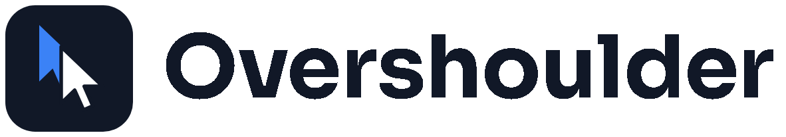
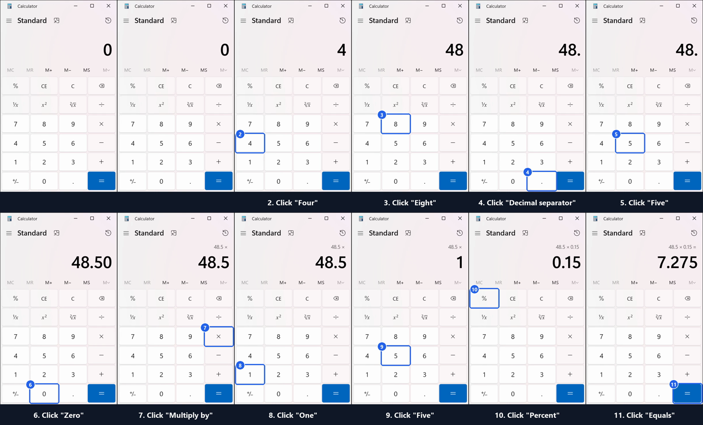
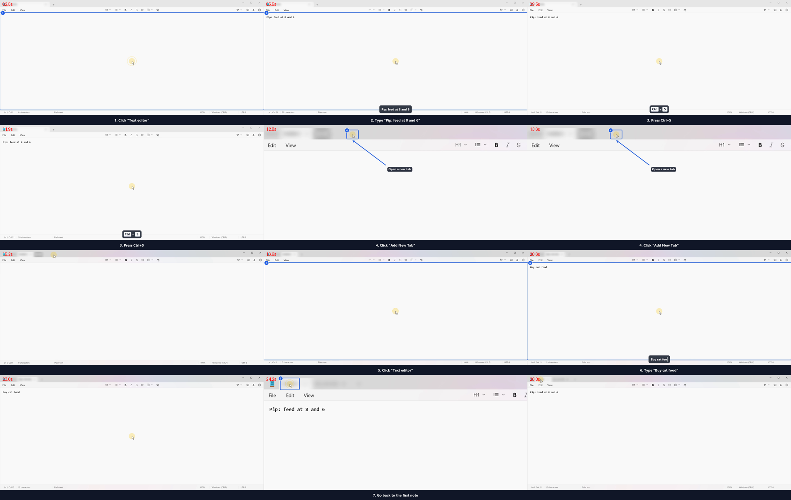

<h1 align="center">
  <picture>
    <source media="(prefers-color-scheme: dark)" srcset="docs/brand/header-dark.png">
    
  </picture>
</h1>

<p align="center"><b>Your agent works in its window. Your desk stays yours.</b></p>

<p align="center">
  
  
  
  
</p>

A desktop hand for AI agents on Windows. An agent leases one window (or a whole screen), sees its
controls, clicks and types inside it, and can record what it did as a tutorial with numbered steps.
Any agent that speaks MCP can use it: Claude Code, Codex, Gemini CLI, or a plain script.



*An agent recorded this on its own, through MCP: "How to work out a 15% tip on a $48.50 bill in
Windows Calculator". Video, step images and `steps.md` are in [docs/demo/calculator-tip](docs/demo/calculator-tip).*

Agents work on their window in the background, so the person at the desk keeps their own cursor and
keyboard. See [Working beside you](#working-beside-you).

Status: phase 2. Windows 10/11 only.

## Install

Needs Python 3.11+ and `ffmpeg` on `PATH` (for recording).

```powershell
git clone https://github.com/drknowhow/overshoulder
cd overshoulder
python -m venv .venv
.venv\Scripts\pip install -e .
```

Run Overshoulder from a normal user session. It refuses to start elevated.

## Quick start

Start the gateway and the watchdog, each in its own terminal:

```powershell
overshoulder serve      # MCP at http://127.0.0.1:47621/mcp
overshoulder watchdog   # panic key, human-input pause, scope outline, agent pointer
```

To start both at every login instead (per-user scheduled tasks, not elevated, restarted if they
crash; logs in `%LOCALAPPDATA%\Overshoulder\logs`):

```powershell
overshoulder autostart install     # also: status, uninstall
```

Create a client for each agent. The token is printed once; only its hash is stored.

```powershell
overshoulder client add claude-code
```

Register it with your agent, for example Claude Code:

```powershell
claude mcp add --transport http overshoulder http://127.0.0.1:47621/mcp --header "Authorization: Bearer <token>"
```

Then ask the agent something like "take the Notepad window as your scope and type a shopping list".

## What an agent can do

| Tool | Does |
|---|---|
| `windows` | List windows it could take as a scope |
| `take_scope` | Lease `window:<hwnd>`, `screen:<n>` or `screen:all` |
| `observe`, `find`, `read` | See the scope's controls (with refs like `e12`), filter them, read values |
| `act` | `click`, `double_click`, `right_click`, `drag`, `invoke`, `toggle`, `select`, `set_value`, `type`, `hotkey`, `focus`, `activate`, each verified afterwards |
| `screenshot` | Image of the scope |
| `record_start`, `record_stop` | Record the scope and render a tutorial |
| `redact` | While recording, hide an element in every frame of the tutorial |
| `annotate`, `render` | Edit one of its recordings' annotation layer and render it again |
| `release_scope`, `status` | Give the desktop back; see who is driving |

Agents should prefer element refs and `invoke`/`set_value`. Coordinates work as well, for canvas
apps and other apps whose controls Windows can't see. `act` takes `method`. `auto` (the default) works
in the background and uses the person's mouse and keyboard only when nothing else reaches the app and
their settings allow it; `background` never uses them; `input` uses them straight away. Each result
says which method ran and whether it was a background one.

A drag goes from `ref` or `x`/`y` to `to_ref` or `to_x`/`to_y`. Both ends must be in scope, and a drop
onto something that discards or sends (a Recycle Bin, a "Delete" target) asks the person first.

## Safety model

The gateway is the only path to the desktop. Every action goes through the same checks, and every
refusal is logged.

- **One driver at a time.** An agent holds a lease with a time limit, and others queue behind it.
- **Scope.** A window scope is tied to that window and the process instance that owns it. Background
  actions go only to the scope's own windows. When real input is used, the click target is checked
  against the window actually under the pointer, and keystrokes are refused if focus has left the
  scope. Taking a whole screen needs a person's approval.
- **Hard denies, in every scope.** Agents can't act on:
  - the secure desktop (UAC prompts, the lock screen)
  - elevated windows
  - password fields, including a focused one when no target is given
  - Win-key combos, Alt+Tab, Alt+Esc and Ctrl+Esc
  - Overshoulder's own windows

  If one of these checks can't tell, the answer is no.
- **Approvals.** Clicking a control named like *Send*, *Delete*, *Buy*, *Pay* or *Install*, pressing
  Delete or Alt+F4, or pressing Enter in a single-line field all need a one-time Yes from the person
  at the desk. The prompt defaults to No after 60 seconds.
- **Narrowing.** A session can do less than its scope allows. `read_only` refuses every action but
  observing, screenshots and recording; `no_typing` refuses typing, `set_value` and hotkeys;
  `deny_processes` (for example `chrome.exe`) takes a program's windows out of the scope, so agents
  can't act on them or see them in `windows()`, `observe` or `wait_for`, and screen screenshots and
  recordings show them as black boxes. An agent can ask for these in `take_scope`. You can set them
  for a client, and its agent can't lift them:

  ```bash
  overshoulder client limit claude-code --no-typing --deny-process chrome.exe
  ```

  A refusal comes back as `narrowed`, with the limit and who set it.
- **The person always wins.** While you use the mouse or keyboard, agents keep to background work,
  and anything that needs your real input waits until you've been idle for a few seconds. Touching
  them during such an action stops it. **Ctrl+Alt+P** revokes the lease and pauses until you run
  `overshoulder resume`.
  The watchdog is a separate process, so agents can't stop it. It outlines the active scope and
  shows the agent's own blue pointer where it last acted; neither appears in recordings.
- **Logs.** Every action goes to a JSONL file in `%LOCALAPPDATA%\Overshoulder\logs`. Typed text is
  recorded only as its length, unless the agent took the scope with `log_text=true` (needed for
  tutorial captions).
- **Recordings and screenshots stay in scope.** For a window scope, both capture that window's own
  pixels, even when something covers it, so your other windows never reach the agent.

## Working beside you

Agents act on their window in the background first: UI Automation, then messages sent to the window
itself. Your cursor doesn't move, and the app you're using keeps the keyboard. Some apps respond only
to a real mouse or keyboard, and `overshoulder settings` sets whether an agent may then use yours:

- **Never.** Those actions are refused with `needs_real_input`, and the agent has to ask you.
- **Only while I'm idle** (the default). An agent may borrow them once you've left them alone for a
  few seconds (5 unless you change it). It brings its window forward, acts, then puts your cursor and
  your window back. A menu or dialog it opened stays in front for its next step, for up to 30 seconds.
  If you move while it works, it stops and leaves things as they are.
- **Full control.** An agent may use them whenever it needs to.

In every mode, touching the mouse or keyboard stops an agent that is using them.

What works in the background depends on the app. Overshoulder tries, in order: a Win32 control's own
message (`BM_CLICK`, `WM_SETTEXT`, `EM_REPLACESEL`), UI Automation, then messages posted to the window
(characters, clicks, drags, and hotkeys with their modifiers set in the app's own key state). The measurements
are in [docs/SPIKE-phase2.md](docs/SPIKE-phase2.md). In
[docs/evidence/phase2-e2e-never](docs/evidence/phase2-e2e-never), a headless Claude agent works in
Notepad, Calculator and Character Map with the input mode set to "never". Sampled every 50 ms for
56 seconds, the person's window stayed in front, the cursor did not move, and no input was injected.
[docs/evidence/phase2-borrow](docs/evidence/phase2-borrow) shows a borrowed click that waited for
the person to stop using the PC, then put their cursor and window back.

## Waiting for the person

When an agent needs you to do something (sign in, approve, finish a form), it can watch for the
result instead of asking you to say "done". `overshoulder wait` exits 0 as soon as any condition
holds, and 3 on timeout. Hosts that run background commands, such as Claude Code, pick the work
back up automatically. Agents can also use the `wait_for` tool.

```powershell
overshoulder wait --window-appears "Order confirmed"
overshoulder wait --window-closes "Installing" --file "C:\Users\me\Downloads\report.pdf"
overshoulder wait --json '{"kind": "element_appears", "title_re": "Setup", "name": "Finish"}'
```

Detection only reads window titles, on-screen controls and files. `overshoulder settings` opens a
local page where you switch it on or off, choose what agents may watch, limit it to particular apps,
and set how often it checks and how long it may wait.

## Tutorials



`record_start` captures a clean video of the scope. `record_stop` renders it into `tutorial/` inside
the recording's folder (`%LOCALAPPDATA%\Overshoulder\recordings\<stamp>-<name>`):

- `tutorial.mp4`: the agent's pointer gliding to each target, click ripples, numbered highlights and
  a caption strip, with the idle time between steps cut. The camera zooms in on small targets and
  back out. Hotkeys show as keycaps, and typed text appears as a caption while it is typed.
- `tutorial.gif`, 640 px wide, for a README or a chat.
- `step-NN.png` for each step (always the whole frame), `steps.md` and `steps.json`.
- With narration: a voice track in the MP4, plus `narration.wav` and `narration.srt`. Each line starts
  with its step's caption. When a line runs longer than its step, the video holds on the frame just
  before the pointer moves on, until the line ends.

The original video is never changed. Everything added on top comes from `annotations.json` beside it,
which the agent or you can edit before rendering again:

| Kind | Fields | Does |
|---|---|---|
| `box` | `rect`, `text`?, `color`? | Outlined box, optionally labelled |
| `arrow` | `tail`, `head`, `color`? | Arrow pointing at `head` |
| `text` | `at`, `text`, `size`?, `color`? | Label on a dark pill |
| `badge` | `at`, `text`? | Round badge |
| `spotlight` | `rect` | Dims everything outside `rect` |
| `redact` | `rect`, `style`? | `blur` (default), `pixelate` or `solid`, in every output |
| `step` | `step`, `caption`?, `hidden`?, `narration`?, `audio`? | Edits one step: its caption, whether it shows, what it says |
| `cut` | `t0`, `t1` | Drops that part of the recording and the steps in it |
| `crop` | `rect` | Crops every output |

Coordinates are pixels of the recorded frame, the same pixels `steps.json` uses for each step's
`rect`. A drawn item shows during one step (`step`: that step's id), between `t0` and `t1` seconds,
or throughout. Items from the [example](docs/evidence/tutorial-annotate):

```json
{"id": "a1", "kind": "redact", "rect": [56, 12, 363, 52], "style": "blur", "note": "redacted by ref e72"},
{"id": "a2", "kind": "arrow", "step": 4, "head": [387, 55], "tail": [507, 145]},
{"id": "a4", "kind": "step", "step": 3, "narration": "Press Control S to save the first note."}
```

Agents do the same over MCP. `redact(ref)` while recording hides an element's rectangle in every
frame. `annotate(recording, op)` lists the steps and items, or adds, edits or removes items.
`render(recording, ...)` renders again (`zoom`, `keys`, `gif`, `narrate`, `voice`, `pointer`). An
agent can annotate and render only its own recordings, and these two still work after it releases
the scope. From the command line:

```powershell
overshoulder annotate <dir> list
overshoulder annotate <dir> add arrow --step 4 --tail 507,145 --head 387,55
overshoulder annotate <dir> add step --step 3 --narration "Press Control S to save."
overshoulder render <dir> --narrate --voice Zira     # also: --zoom off, --no-keys, --no-gif, --pointer real
overshoulder render <dir> --tts-cmd "piper -m en.onnx -f {out} < {text_file}"
overshoulder voices
```

A screenshot takes a layer too: `overshoulder annotate shot.png add box --rect 10,10,200,80` writes
`shot.annotations.json`, and `overshoulder render shot.png` writes `shot.annotated.png`.

In [docs/evidence/tutorial-annotate](docs/evidence/tutorial-annotate), a headless agent records,
redacts, annotates and narrates a Notepad tutorial on its own, working in the background.

## Limits (phase 2)

- Windows only. Multi-monitor and mixed-DPI setups are untested; development used one 125% monitor.
- Chromium and Electron apps take typing only while they are in front (measured on VS Code; Chrome
  itself is untested), so typing into them needs real input: borrowed in "borrow" mode, refused in
  "never" mode. Clicks and UI Automation work on them in the background.
- UWP and XAML apps such as Calculator ignore posted clicks. UI Automation's Invoke on them brings the
  app forward for a moment, and Overshoulder puts the person's window straight back. Typing into them
  does not. The new Notepad's menus (XAML flyouts) do not open in the background.
- Drags in the background work in apps that read the pointer from each message (Win32, WinForms).
  Explorer, list and tree views start drags from the real mouse, and Tk follows the real cursor while
  a button is held, so dragging in them needs real input: borrowed in "borrow" mode, refused in
  "never" mode. A drop into another window always needs real input.
- Apps that hide their controls from UI Automation (canvases, games) can only be driven by
  coordinates. Verification for them is a screenshot difference.
- Screen-scope recordings use desktop capture, so anything on that screen is recorded, except the
  windows of programs the session is denied.
- A redaction is a fixed rectangle of the recorded frame. If the control it covers scrolls or moves
  inside the window, the redaction stays where the control was.
- Narration uses the voices System.Speech can see (`overshoulder voices` lists them; an English
  Windows 11 has David and Zira). For any other engine, render from the CLI with `--tts-cmd`.
- The plan's Shotcut `.mlt` export is not built.

## Development

```powershell
pip install -e ".[dev]"
pytest -q                                   # unit tests, CI runs these
$env:OVERSHOULDER_DESKTOP_TESTS = "1"; pytest -q   # plus live tests that open real apps
```

Design notes: [docs/PLAN.md](docs/PLAN.md), [docs/SPIKE-phase0.md](docs/SPIKE-phase0.md),
[docs/SPIKE-phase2.md](docs/SPIKE-phase2.md).
Evidence from live runs: [docs/evidence](docs/evidence).

## License

MIT. See [LICENSE](LICENSE).
