# Steps

1. Click "Clear"

   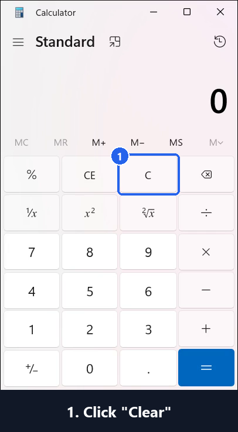

2. Click "Four"

   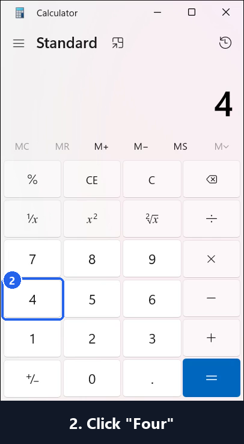

3. Click "Eight"

   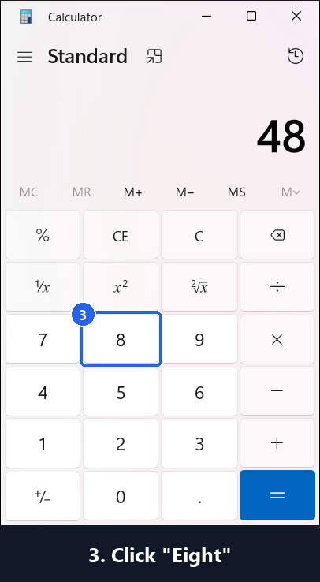

4. Click "Decimal separator"

   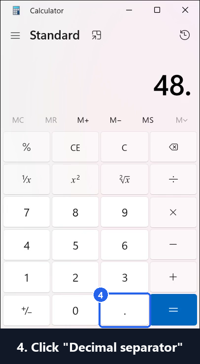

5. Click "Five"

   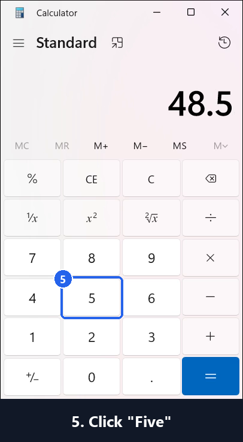

6. Click "Zero"

   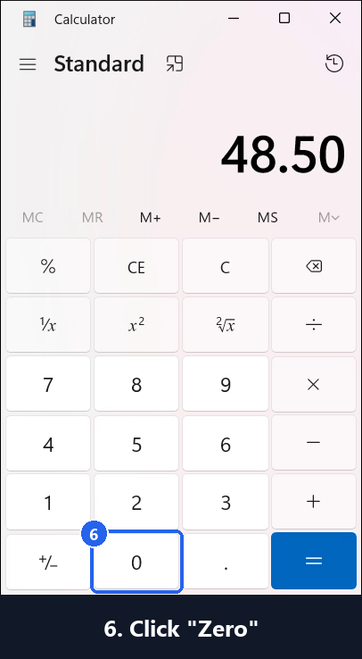

7. Click "Multiply by"

   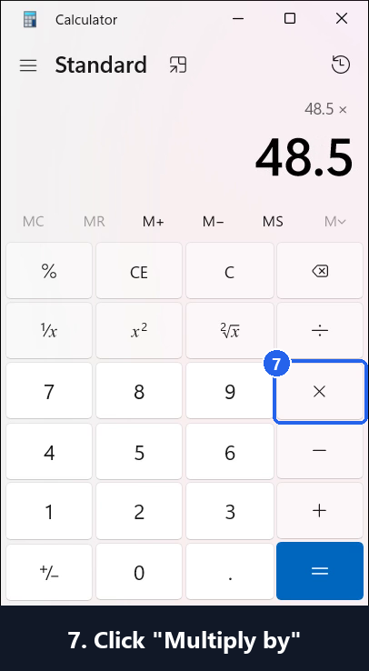

8. Click "One"

   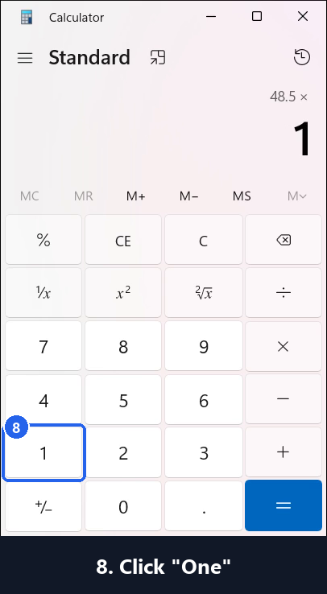

9. Click "Five"

   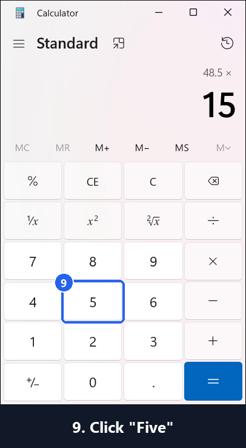

10. Click "Percent"

   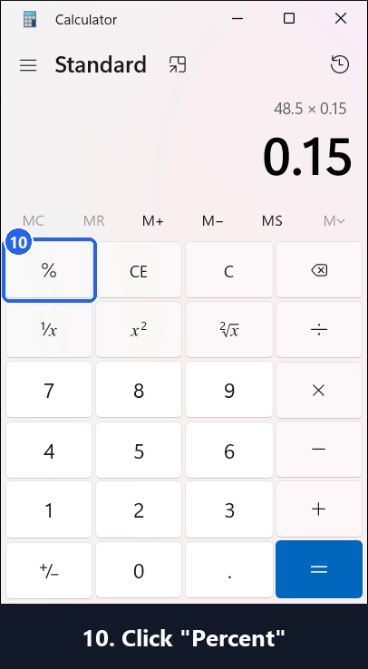

11. Click "Equals"

   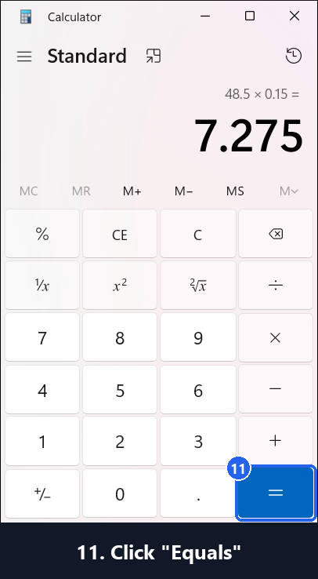

